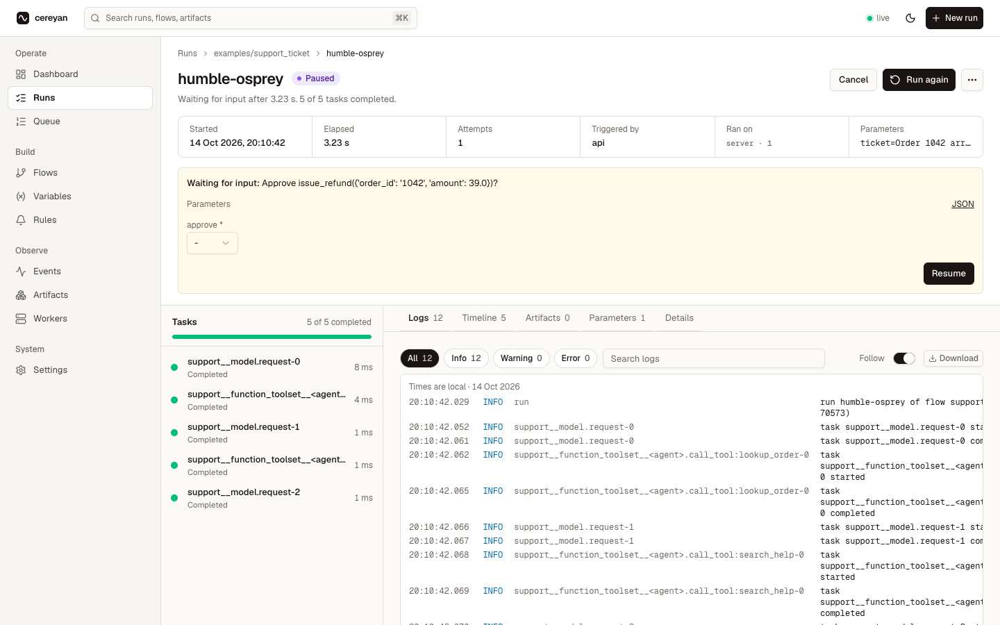
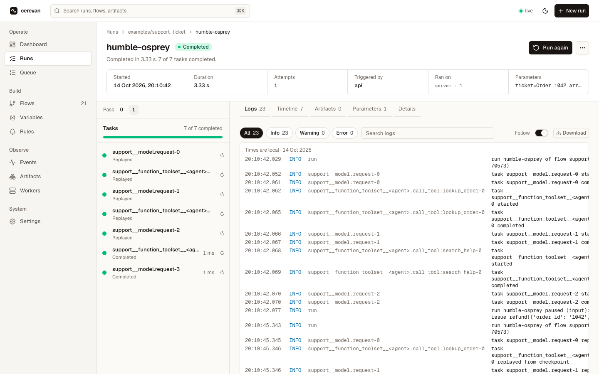

# Durable agent

A Pydantic AI support agent whose model requests and tool calls are task runs, paused for a refund approval and replayed on resume.

Source: [`examples/durable_agent.py`](https://github.com/sercanatalik/cereyan/blob/main/examples/durable_agent.py). Run it with `python examples/durable_agent.py` while `cereyan serve examples/` is running.

Needs the optional extra: `pip install "cereyan[pydantic-ai]"`.

A support agent reads a ticket, looks up the order, checks the help centre, and
proposes a refund. Refunds need a person's approval. `CereyanDurability` makes every
model request and tool call a task run of the flow's run, with its result
checkpointed. So when the run pauses for the approval and resumes, the agent's
earlier work is replayed from the checkpoints instead of being paid for again.
Run it against `cereyan serve examples/`.

```python
import os
import time

from pydantic_ai import Agent, DeferredToolRequests, DeferredToolResults
from pydantic_ai.messages import ModelResponse, TextPart, ToolCallPart
from pydantic_ai.models.function import FunctionModel

from cereyan import client, flow, wait_for_input
from cereyan.pydantic_ai import CereyanDurability
```

## The model

The example plays a scripted conversation, so it runs the same way every time: look
up the order, search the help centre, then propose the refund. Set `AGENT_MODEL` to a
real one, such as `openai:gpt-5` with `pydantic-ai-slim[openai]` installed, and the
replies change while everything durable stays the same.

```python
def scripted(messages, info):
    last = messages[-1].parts[-1]
    if last.part_kind == "user-prompt":
        return ModelResponse(parts=[ToolCallPart("lookup_order", {"order_id": "1042"}, tool_call_id="look-1")])
    if getattr(last, "tool_name", None) == "lookup_order":
        return ModelResponse(parts=[ToolCallPart("search_help", {"topic": "damaged on arrival"}, tool_call_id="help-1")])
    if getattr(last, "tool_name", None) == "search_help":
        return ModelResponse(parts=[ToolCallPart("issue_refund", {"order_id": "1042", "amount": 39.0}, tool_call_id="refund-1")])
    return ModelResponse(parts=[TextPart(f"Order 1042 is sorted: {last.content}")])


support = Agent(
    os.environ.get("AGENT_MODEL") or FunctionModel(scripted),
    name="support",
    instructions="You resolve support tickets. Refund damaged items; refunds need approval.",
    output_type=[str, DeferredToolRequests],
    capabilities=[CereyanDurability()],
)
```

## The tools

Two tools only read, and `issue_refund` moves money, so it asks first:
`requires_approval=True` makes the agent run end with the call as a deferred
request instead of executing it.

```python
ORDERS = {"1042": {"item": "kettle", "paid": 39.0, "status": "arrived broken"}}


@support.tool_plain
def lookup_order(order_id: str) -> dict:
    return ORDERS[order_id]


@support.tool_plain
def search_help(topic: str) -> str:
    return "Items damaged on arrival are refunded in full; no return is needed."


@support.tool_plain(requires_approval=True)
def issue_refund(order_id: str, amount: float) -> str:
    return f"refunded {amount:.2f} for order {order_id}"
```

## The flow

The first agent run ends with the refund waiting for approval. The flow asks a
person with `wait_for_input`, which pauses the run and frees its engine. When the
answer arrives the run executes again from the top: the first agent run replays its
model requests and tool calls from their checkpoints, the question returns the
answer, and a second agent run continues with it.

```python
APPROVE = {"type": "object", "properties": {"approve": {"type": "boolean"}}, "required": ["approve"]}


@flow(group="agents")
def support_ticket(ticket: str = "Order 1042 arrived broken. I want my money back.") -> str:
    first = support.run_sync(ticket)
    if not isinstance(first.output, DeferredToolRequests):
        return first.output
    approvals = {}
    for call in first.output.approvals:
        answer = wait_for_input(f"Approve {call.tool_name}({call.args_as_dict()})?", schema=APPROVE)
        approvals[call.tool_call_id] = bool(answer["approve"])
    results = DeferredToolResults(approvals=approvals)
    return support.run_sync(message_history=first.all_messages(), deferred_tool_results=results).output
```

## What you see

The run pauses on the refund. The banner asks the question with a form built from
its schema, and the tasks rail lists the agent's work so far as task runs: three
model requests and the two read-only tool calls, named after the agent.



After the answer the run executes again from the top. Pass 1 shows the first agent
run's model requests and tool calls as `Replayed`, so the model was not asked again,
then the approved refund and the model's final reply.



## Driving it from a script

Start the run, approve the refund when it asks, and wait for the result. Then read
the run's task runs: the pass after the approval shows the first agent run's model
requests and tool calls as `Replayed`.

```python
def wait_for(run_id: int, predicate, timeout: float = 60.0) -> dict:
    deadline = time.time() + timeout
    while time.time() < deadline:
        run = client.get_run(run_id)
        if predicate(run):
            return run
        time.sleep(0.2)
    raise TimeoutError(f"run {run_id} did not reach the expected state")


if __name__ == "__main__":
    run = client.run("support_ticket")
    paused = wait_for(run["id"], lambda r: r["state"]["type"] == "Paused")
    print("question:", paused["state"]["details"]["prompt"])
    client.default_client().resume(run["id"], {"approve": True})
    done = wait_for(run["id"], lambda r: r["state"]["type"] in ("Completed", "Failed", "Crashed", "Cancelled"))
    print("run", done["name"], "ended", done["state"]["type"])
    assert done["state"]["type"] == "Completed", done["state"]
    tasks = client.default_client().task_runs(run["id"])
    replayed = [t["dynamic_key"] for t in tasks if t["pass"] == 1 and t["state"]["name"] == "Replayed"]
    print("replayed on resume:", ", ".join(replayed))
    assert any("model.request" in key for key in replayed), replayed
```
